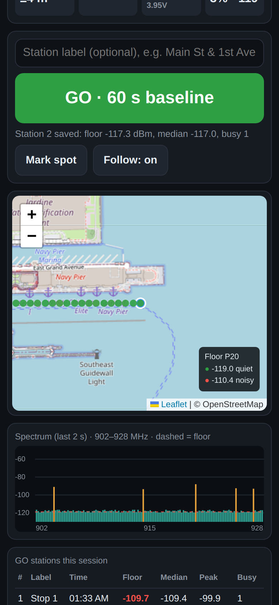
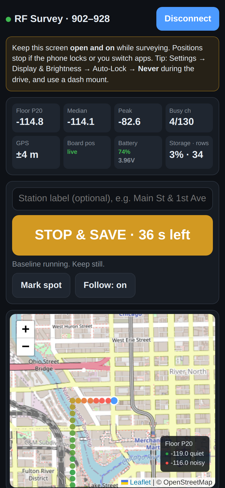
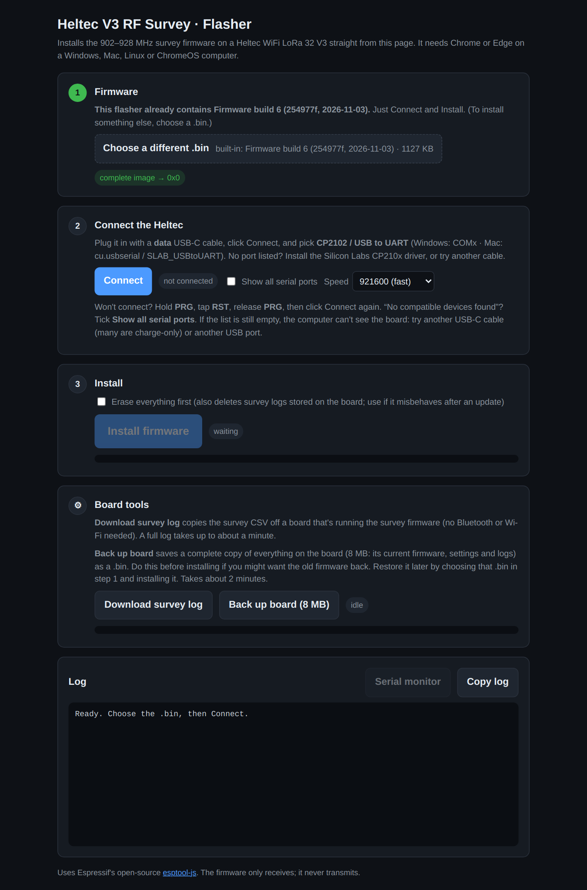

# Heltec V3 RF Survey: 902–928 MHz noise floor + GPS map

Receive-only firmware for the **Heltec WiFi LoRa 32 V3**. It sweeps the 902–928 MHz ISM band (used by LoRa, smart-meter RF mesh networks and many other devices) and logs the noise floor every 2 s while you drive. At each stop you press **GO** to record a 60-second baseline ("station") for that spot. The iPhone supplies live GPS over Bluetooth through the free **Bluefy** app. The radio never transmits.

```
firmware/                 PlatformIO project (source)
flasher/index.html        one-click browser flasher (open locally in Chrome/Edge)
.github/workflows/        builds a ready-to-flash .bin on every change → Releases
analyze/survey_map.py     PC script: log + iPhone GPX → map.html, KML, CSVs, plots
docs/                     screenshots + the script that makes them
```

There's also the **RF Survey Viewer** web app on Claude: load the CSV + GPX on your phone or PC to get the map, stations, spectrum and waterfall. No install needed.

## Screenshots

| Live survey (Bluefy on iPhone) | GO station running | Flasher (computer) |
|---|---|---|
|  |  |  |

Full control page: [docs/screenshots/control-full.png](docs/screenshots/control-full.png).
*These are generated automatically by the **Screenshots** workflow using a simulated board and GPS route, so they show no real survey location. To refresh them: Actions → Screenshots → Run workflow.*

## 1. Hardware

- Heltec WiFi LoRa 32 V3 with the Laird 902–928 MHz 3 dBi antenna. The V3 has a **U.FL (IPEX)** jack, so you need a U.FL pigtail that fits the Laird's connector. Keep it short, since every dB of cable loss lowers your readings.
- USB power bank (the board draws about 100–150 mA).
- **Mount the antenna vertically and outside the vehicle if you can** (a roof magnet mount is ideal). Inside a car body you lose 6–15 dB, and the loss changes with direction.
- Optional: a u-blox NEO-6M/M8N GPS module (TX→GPIO47, RX→GPIO48, 3V3, GND). You don't need it if you use the iPhone.

## 2. Flash it (no software install)

You need a **computer** with Chrome or Edge. An iPhone can't flash USB devices.

**Use it online:** open **https://charlesphillips3.github.io/heltec-rf-noise-survey/** in Chrome or Edge. It's the same flasher with the newest firmware built in, updated automatically on every build. Then skip to step 3.

**Or use it offline:**
1. On GitHub, open this repo → **Releases** (right side) → newest **Firmware build** → download **`heltec-flasher.html`**. It has that build's firmware **built in**.
2. **Double-click** it so it opens in Chrome or Edge.
3. Plug the Heltec into the computer with a **data** USB-C cable. Windows may need the **CP210x** driver from Silicon Labs if no port appears.
4. In the flasher: **Connect** (pick *CP2102 / USB to UART*) → **Install firmware**. It writes, verifies, restarts the board and shows its startup log.
   If it won't connect, hold **PRG**, tap **RST**, release **PRG**, then click Connect again, or pick a lower speed. Coming from Meshtastic or other firmware? Tick **Erase everything first**.
5. The OLED shows *RF Survey 902-928*, then *Floor … Med …*. The first boot takes a little longer while it formats log storage.

**Flasher board tools:** **Download survey log** copies the CSV straight off the board over USB and opens the **analysis report** on screen (map, GO stations, noisiest spots, spectrum, waterfall); **Save report** makes a single HTML file to share. **Analyze survey…** opens any saved CSV. **Back up board** saves a full 8 MB copy of whatever is on the board, such as Meshtastic, so you can restore it later by choosing that .bin and installing it.

*Alternative:* Espressif's own web flasher, **https://espressif.github.io/esptool-js/**. Connect, enter Flash Address **0x0**, choose the `.bin`, and click Program.

New firmware is built automatically whenever `firmware/` changes, and the newest one is always at the top of Releases.
*(Developers: you can also open `firmware/` in VS Code + PlatformIO and click Upload.)*

## 3. In the field (iPhone + Bluefy)

**One-time setup on the iPhone**
1. Install **Bluefy – Web BLE Browser** (free, App Store).
2. In Bluefy, open **https://charlesphillips3.github.io/rf-survey-control/** and bookmark it.
3. When asked, allow **Location** (*While Using*, Precise on) and **Bluetooth**.

**Each survey**
1. Power the Heltec. The screen shows its Bluetooth name, **RF-Survey-XXXX**.
2. In Bluefy, open the bookmarked page → **Connect** → pick **RF-Survey-XXXX**.
   The page sends the phone's clock and GPS to the board; *Board pos* should say **live**.
3. **Keep Bluefy open with the screen on** (Auto-Lock → Never, dash mount). If the phone locks, positions pause; the page reconnects when you come back.
4. Drive. Readings appear on the live map, colored by noise floor.
5. **At each stop:** type a label (optional) → tap **GO**. The board averages 60 s, then the station appears on the map and in the table. Tap again to stop early. Short-pressing **PRG** on the board also works.
6. **When done:** tap **Save CSV**, then pick *Save to Files* from the share sheet. The board also keeps the complete log, with positions included. As a backup, join Wi-Fi **RF-Survey** (pw `survey1234`), open **http://192.168.4.1** and tap **Download CSV**.

**Plan your stops:**
- Do a few **baseline stations several miles away** (same antenna and mounting) to set your "normal".
- Then make a ring or grid of stations around the suspect area, with extra stops on the side facing any suspected source and anywhere the drive readings look high.
- If you see something, revisit the same spot at a different time of day. It may be intermittent.

**Other controls:** *Mark spot* drops a note with no dwell. **Hold PRG 2 s** turns the board's Wi-Fi on/off; you can also toggle it from the page.

**No Bluefy?** The older method still works: record a GPX track with any GPS app, open http://192.168.4.1 once on the board's Wi-Fi to sync the clock, and load the CSV + GPX in the viewer.

## 4. Look at the results

**Easiest:** open the **RF Survey Viewer** app and load the CSV (plus the GPX only if you used the GPX method). You get:
- a drive map colored by noise floor, with GO stations as labeled squares
- a station table with mean spectrum per stop
- the noisiest drive spots with Google Maps links
- spectrum, waterfall and timeline charts
- exports: a street-map HTML, points/stations CSV, GeoJSON

**On a PC with Python 3:**
```
pip install matplotlib
python analyze/survey_map.py rfsurvey_boot3.csv --gpx track.gpx --out results
```
Outputs `map.html`, `survey.kml` (Google Earth), `points.csv`, `stations.csv`, `stations.png`, `spectrum.png`, `waterfall.png` and `timeline.png`.
If the points don't line up with your route, the clocks disagree. Try `--time-shift -2` (or the *Time shift* box in the app).

## 5. Reading the numbers

- **floor_p20** = the 20th-percentile channel level. Devices in this band transmit in short bursts, so a low percentile tracks the real noise floor and ignores normal mesh traffic. **This is the number to compare.**
- **GO stations** are the most trustworthy numbers: 60 s of averaging at a fixed spot (about 180 sweeps). Compare station to station, and against your far-away baseline stations. A drive reading is a 2 s snapshot taken while moving.
- **Station min / max per channel** (in stations.csv and the log) separate steady noise (min is high) from bursts (max is high, min is normal).
- **median / busy** = how much of the band is occupied (more than 10 dB above the floor). **peak** = strongest single reading, and its frequency.
- Readings are **relative and uncalibrated** (0.5 dB steps, absolute dBm may be off by several dB). Keep the same antenna, mounting and setup for every station.
- A rise in the floor across the **whole band** points to broadband noise (power-line arcing, a faulty electrical device, a strong out-of-band emitter overloading receivers). A rise in only a few channels points to a narrowband emitter.
- A survey shows **conditions at the time you drove**. An intermittent source may not be present; repeat surveys or leave the board logging at a fixed spot to catch it.
- Stay on public roads, and don't stop or loiter near secure sites such as military bases.
